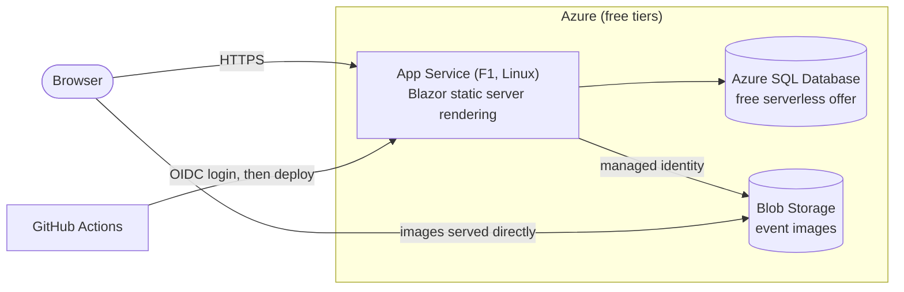

# Event Booking Platform

[](https://github.com/aboutblank0/event-booking-azure/actions/workflows/ci.yml)
[](https://github.com/aboutblank0/event-booking-azure/actions/workflows/deploy.yml)

A web app where organisers publish events and people book places at them, built with
**.NET 10, Blazor and ASP.NET Core Identity** and running on **Azure** entirely on free tiers.

**Live site:** <https://jc-eventbooking-f3e9bwgyfyd4fbcg.ukwest-01.azurewebsites.net>
(free tier: the first request after a quiet spell can take a few seconds)

## About this project

I built this to learn **Azure and modern .NET**, starting with no Azure experience, and to practise
**agentic coding** with [Claude Code](https://claude.com/claude-code) as a pair programmer. Every
feature is designed first, then built in small reviewed pull requests, with tests for every business rule.
I make the design decisions and aim to understand every line.

## Features

- **Everyone:** browse upcoming events with images, a venue map and places left; times shown in the
  venue's time zone.
- **Users:** book and cancel places, see upcoming and past bookings, apply to become an organiser.
  Accounts support email confirmation, two-factor authentication and passkeys.
- **Organisers:** create, edit, publish and cancel events with image galleries, and see who is attending.
- **Admins:** review organiser applications, manage user roles, lock accounts and cancel any event.

## Technical highlights

- **Concurrency handled correctly:** no double-booking, overbooking or lost updates, with each race
  condition reproduced in a test against a real SQL Server.
- **Permissions enforced at the moment of the action**, with role changes and lockouts taking effect immediately.
- **Secure image uploads** validated by content, with size and storage limits.
- **No secrets in the repository**, and passwordless access to Azure from both the app and CI.
- **Business rules in a separate Core project**, tested in isolation with an injectable clock.
- **Correct time zone handling**, including clock changes.

## Architecture



**Stack:** .NET 10 · Blazor · ASP.NET Core Identity · EF Core 10 · SQL Server · Azure Blob Storage ·
xUnit · Testcontainers · GitHub Actions

| Project | Contents |
|---------|----------|
| `src/EventBooking.Core` | Entities and business rules |
| `src/EventBooking.Web` | Blazor pages, services, database, Identity, storage |
| `tests/EventBooking.Tests` | Unit and integration tests |

## Testing and deployment

- **256 tests**, with database tests running against a real SQL Server in Docker.
- **CI** builds and tests every pull request; every merge to `main` is deployed to Azure automatically.
- **Free tiers only:** App Service F1, Azure SQL free offer, and Blob Storage, with a budget alert.

## Roadmap

- [ ] Infrastructure as code with Bicep
- [ ] Monitoring with Application Insights and a health check
- [ ] Real emails (confirmations and cancellation notices)
- [ ] Let organisers who have events delete their account

## Running it yourself

Needs the .NET 10 SDK, Docker and the Azure CLI.

1. Copy `.env.example` to `.env` and choose a SQL Server password.
2. Set your local settings with [User Secrets](https://learn.microsoft.com/aspnet/core/security/app-secrets):

   ```bash
   dotnet user-secrets set "ConnectionStrings:DefaultConnection" "Server=localhost,1433;Database=EventBooking;User Id=sa;Password=<your .env password>;TrustServerCertificate=True" --project src/EventBooking.Web
   dotnet user-secrets set "Storage:BlobEndpoint" "https://<your-storage-account>.blob.core.windows.net/" --project src/EventBooking.Web
   dotnet user-secrets set "Admin:Email" "<your email>" --project src/EventBooking.Web
   ```

3. Run `az login`. Your account needs the **Storage Blob Data Contributor** role on the storage account.
4. Start the database and the app:

   ```bash
   docker compose up -d
   dotnet watch --project src/EventBooking.Web
   ```

The `Admin:Email` user gets the Admin role at startup, once registered and confirmed. On Azure, register
and confirm the admin account on the live site first, then add the app setting `Admin__Email`.
