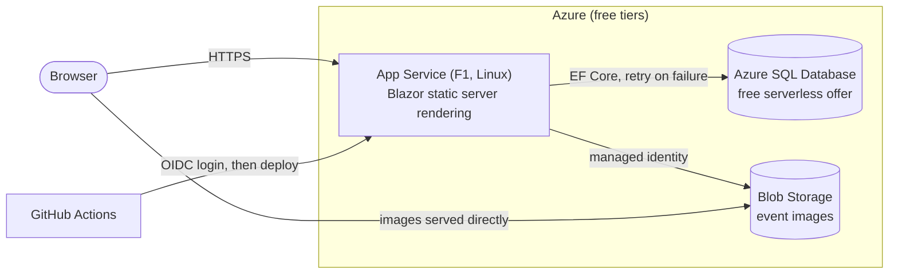

# Event Booking Platform

[](https://github.com/aboutblank0/event-booking-azure/actions/workflows/ci.yml)
[](https://github.com/aboutblank0/event-booking-azure/actions/workflows/deploy.yml)

A web app where organisers publish events and people book places at them, built with
**.NET 10, Blazor and ASP.NET Core Identity**, running on **Azure** (App Service, Azure SQL, Blob
Storage) entirely on free tiers, and deployed by GitHub Actions without any stored credentials.

**Live site:** <https://jc-eventbooking-f3e9bwgyfyd4fbcg.ukwest-01.azurewebsites.net>
(free tier: the first request after a quiet spell can take a few seconds while the app and database wake up)

## About this project

I built this project to learn two things at once:

- **Azure and modern .NET.** I started with no Azure experience. Each resource was first created by
  hand in the portal to understand its options, then wired up properly (managed identity, OIDC
  deployment). The next step is to describe all of it in Bicep.
- **Agentic coding.** The code was written with [Claude Code](https://claude.com/claude-code) as a pair
  programmer, using a deliberate workflow rather than "generate and hope":
  1. **Design first.** Each feature starts as a design document listing its data model and numbered
     business rules, with open questions that I answer before any code is written.
  2. **Small, reviewable steps.** The agreed design is built in small branches, one pull request per
     step (entity → database → service → pages), each of which I review and merge.
  3. **Rules for the agent.** A project instructions file sets the ground rules: no new packages
     without asking, no secrets in code, every feature needs tests, `dotnet test` must pass before a
     task counts as done, free Azure tiers only.
  4. **Tests as the safety net.** Every business rule has at least one test, including tests that
     recreate race conditions against a real SQL Server.

The aim was to understand every part of the result, not just to produce it: the agent explains
non-obvious code as it goes, and I make the design decisions.

## Features

### For everyone
- Browse upcoming events with their cover image, venue, date and places left.
- Event pages with an image gallery and the venue on a map (Leaflet / OpenStreetMap).
- Times are shown **as they are at the venue**, whatever the viewer's or server's time zone.

### For signed-in users
- **Book a place** and cancel it up to the start of the event. A cancelled place is freed immediately.
- **My bookings**: upcoming and past events, with cancelled or unavailable events clearly marked.
- **Apply to become an organiser**, from the account page or with a combined "register as organiser"
  form. Rejected applicants can reapply after a month.
- Accounts from ASP.NET Core Identity: email confirmation, two-factor authentication and passkeys.

### For organisers
- Create events as drafts, upload up to 5 images, pick the venue on a map, then publish.
- Edit details while protecting attendees: the date can't change once the event is published, and
  capacity can't drop below the number of places already booked.
- Cancel published events (never deleted, so bookings always point at a real event) and delete drafts
  (their images are removed from storage too).
- See who is attending each event.

### For admins
- Review organiser applications (approve, or reject with an optional reason).
- Manage users: remove the Organiser role, give or remove the Admin role, lock or unlock accounts.
- Cancel any event and see the attendees of any event.

## Technical highlights

### Concurrency: no double-booking, no lost updates
Two requests can change the same data at once, for example two people booking the last place. The app
handles each kind of race explicitly:

| Race | Protection |
|------|------------|
| Two people book the last place, or an organiser lowers capacity while someone books | Booking writes also touch the event row, so its SQL Server `rowversion` is checked (**optimistic concurrency**). The losing request is retried once with fresh data, then gets the real reason ("this event is now full"). |
| Two admins review the same application, or two edits of one event | `rowversion` concurrency tokens: the stale save fails instead of silently overwriting. |
| Double-clicking "Book" or "Apply" | Filtered unique indexes (one *confirmed* booking per user per event; one *pending* application per user) as a database-level backstop. |
| Two image uploads into one event at once | Unique index on the image order, plus the event's `rowversion`. A failed save also deletes the file it just uploaded. |
| Approving an application and granting the Organiser role | Both in one `SaveChanges`, so in one transaction: either both happen or neither does. |

Each of these has an integration test that **reproduces the race against a real SQL Server**: an EF Core
`SaveChangesInterceptor` lets a second "request" save in between the first one loading and saving.

### Security and permissions
- **Role changes apply immediately.** The login cookie is checked against the database on every
  request, so a newly approved organiser gets their role on the next page load, and a locked or
  demoted user is signed out straight away.
- **Permission checks read the database at the time of the action**, not the roles the page was
  loaded with, so a stale browser tab can't act on permissions the user no longer has.
- **Role and ownership both checked**: having the Organiser role lets you create events, but you can
  only manage your own.
- **Hidden events are derived, not stored.** When an organiser is demoted or locked, their events
  disappear from public view; restore them and everything reappears unchanged.
- **Admin safeguards**: the configured admin can't be demoted or locked, and admins can't demote or
  lock themselves, so there's always an admin who can sign in.
- **Image uploads are validated by content** (file signature, not extension), limited to 2 MB, stored
  under server-generated names, and capped in total to keep storage costs bounded.
- **No secrets in the repository**: user secrets locally, App Service settings in Azure, and
  passwordless access to Blob Storage and to Azure from CI.

### Design
- **Business rules live in a separate Core project** with no web or database code: entities enforce
  their own rules (e.g. allowed status changes Draft → Published → Cancelled) and are tested in isolation.
- **Time is injected** (`TimeProvider`), so rules like "can't book after the event starts" are tested
  with a fixed clock.
- **Time zones done properly**: events store the exact moment (`DateTimeOffset`) plus the venue's IANA
  time zone, and reject clock times that don't exist when the clocks go forward.

## Architecture



| Project | Contents |
|---------|----------|
| `src/EventBooking.Core` | Entities and business rules. No web or database dependencies. |
| `src/EventBooking.Web` | Blazor pages, services, EF Core mapping and migrations, Identity, Blob Storage. |
| `tests/EventBooking.Tests` | xUnit unit and integration tests. |

**Stack:** .NET 10 · Blazor (static server-side rendering) · ASP.NET Core Identity · EF Core 10 ·
SQL Server · Azure Blob Storage · xUnit · Testcontainers · GitHub Actions

## Testing

```bash
dotnet test   # needs Docker running, for the SQL Server container
```

- **256 tests** covering the business rules, the services and the database mapping.
- Database tests run against a **real SQL Server in Docker** via Testcontainers, not an in-memory fake,
  because rowversions, unique indexes and transactions behave differently there.
- Image storage is replaced by a fake in tests, so they need no Azure access.

## Deployment

- **CI** builds and tests every pull request.
- **Deploy** runs on every merge to `main`: tests, publishes, signs in to Azure with **OpenID Connect**
  (a federated credential trusts this repository, so no Azure password is stored in GitHub), and
  deploys to App Service.
- Database migrations are applied when the app starts.

### Azure resources and cost

| Resource | Tier | Cost |
|----------|------|------|
| App Service | F1 Free (Linux) | Free |
| Azure SQL Database | Free offer, serverless with auto-pause | Free |
| Storage account | Standard LRS | Free for 12 months, then pennies |

A budget alert on the subscription emails me if anything starts costing money.

## Roadmap

- [ ] **Infrastructure as code with Bicep**, so the whole Azure setup can be recreated with one command.
- [ ] Monitoring with Application Insights and a health-check endpoint.
- [ ] Real emails (account confirmation, booking confirmations, event cancelled notices).
- [ ] Let organisers who have events delete their account (currently blocked by the database).

## Running it yourself

Full setup will be automated with Bicep (see the roadmap). Until then, these are the steps.

### Local development

Needs the .NET 10 SDK, Docker, and the Azure CLI.

1. Copy `.env.example` to `.env` and choose a SQL Server password.
2. Store your local settings in [User Secrets](https://learn.microsoft.com/aspnet/core/security/app-secrets)
   (kept outside the repository):

   ```bash
   dotnet user-secrets set "ConnectionStrings:DefaultConnection" "Server=localhost,1433;Database=EventBooking;User Id=sa;Password=<your .env password>;TrustServerCertificate=True" --project src/EventBooking.Web
   dotnet user-secrets set "Storage:BlobEndpoint" "https://<your-storage-account>.blob.core.windows.net/" --project src/EventBooking.Web
   ```

3. Choose the admin account. Register it in the app first, confirm its email, then set its email
   address and restart the app. At startup, that user gets the Admin role.

   ```bash
   dotnet user-secrets set "Admin:Email" "<your email>" --project src/EventBooking.Web
   ```

4. Sign in to Azure with `az login`. Locally, the app uses your Azure CLI login to access Blob
   Storage, so your account needs the **Storage Blob Data Contributor** role on the storage account.

Then, from the repository root:

```bash
docker compose up -d                              # starts SQL Server in a container
dotnet watch --project src/EventBooking.Web      # runs the app with hot reload
```

### Steps that stay manual after Bicep

Bicep describes Azure resources, so it can create the App Service, database, storage account,
container, managed identity, role assignments and app settings. These steps are outside its reach
and will still need doing by hand:

| Step | Why Bicep can't do it |
|------|-----------------------|
| User secrets and `.env` on each developer machine | They live on your machine, not in Azure. |
| `az login`, and giving your own account the Storage Blob Data Contributor role | Signing in is interactive. The role assignment *could* go in Bicep, but it needs your account's ID as a parameter. |
| The SQL admin password | Passed as a secure parameter at deploy time, never stored in the Bicep files. |
| GitHub secrets `AZURE_CLIENT_ID`, `AZURE_TENANT_ID`, `AZURE_SUBSCRIPTION_ID` | They're GitHub settings. The app registration and its federated credential are Entra ID objects, which need the separate Microsoft Graph Bicep extension or a one-off manual setup. |
| Registering and confirming the admin account on the live site | That's data in the app, not infrastructure. See below. |

### Setting up the admin on Azure

Production has its own database, so its admin is set up separately from your local one. Do this once,
after the first deploy:

1. **Register on the live site** with the admin's email and confirm it (until the app sends real
   emails, the confirmation link is shown on screen). Do this *before* step 2: otherwise anyone who
   registers with that address first would become the admin.
2. **Add the app setting** `Admin__Email` with that email. App Service passes app settings to the app
   as environment variables, and .NET reads `__` as `:`, so the code sees it as `Admin:Email`.
   Either in the portal (App Service → **Settings → Environment variables** → add it, then **Apply**),
   or with the Azure CLI:

   ```bash
   az webapp config appsettings set --name jc-eventbooking --resource-group <your resource group> --settings Admin__Email=<your email>
   ```

3. **Check it worked.** Saving a setting restarts the app, and at startup it gives that user the Admin
   role. The log stream should show `Gave the Admin role to the Admin:Email user.`:

   ```bash
   az webapp log tail --name jc-eventbooking --resource-group <your resource group>
   ```

   If it logs a warning instead, it says why (e.g. the email isn't confirmed yet). Fix that, then
   restart the app from the portal or with `az webapp restart`.

The setting stays on the App Service, so later deploys and restarts keep the same admin.
